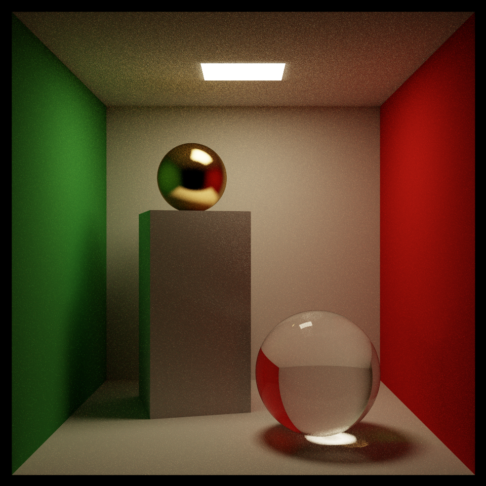
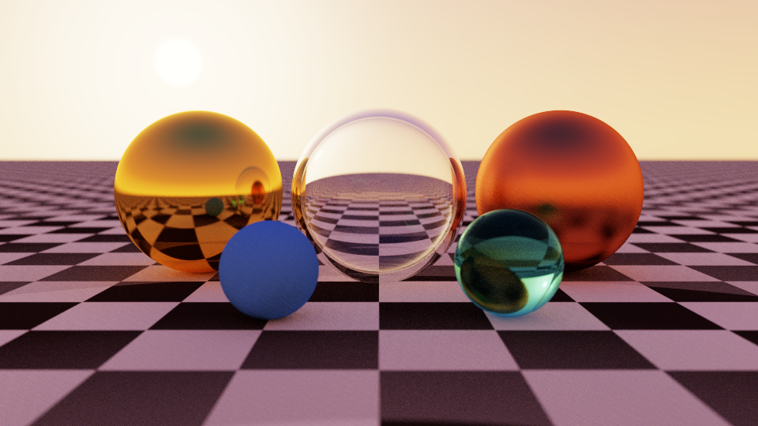
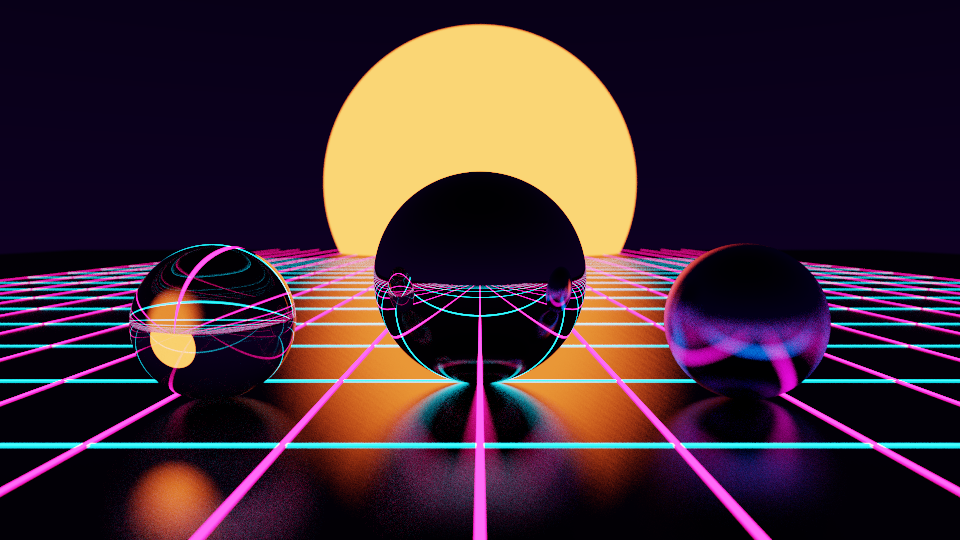
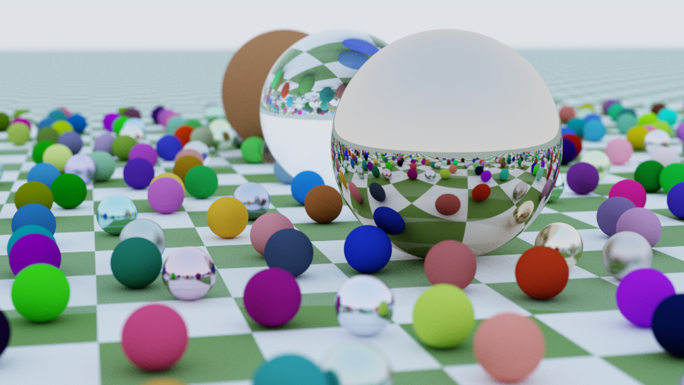

# Rust Learning Playground

## Photon: a path tracer you can read

<p>
  
  
  
  
</p>

Photon is a physically based renderer written in Rust with **zero
dependencies**. The same library runs two ways:

- **Natively**: `photon-cli` renders on every CPU core and writes PNGs with an
  encoder (DEFLATE compression included) written from scratch.
- **In the browser**: `photon-wasm` compiles to an 80 KB WebAssembly module
  driven by one Web Worker per core. You can orbit the camera, zoom, and click
  on any object to focus on it. There's no `wasm-bindgen`: the JS/Rust
  interface is about a dozen hand-written `extern "C"` functions.

It's meant to be read. Every module opens with the Rust concepts it shows,
and the code favours clarity over tricks.

## Quick start

```sh
# Run all 34 tests (math, BVH correctness, light-transport unbiasedness, PNG/DEFLATE round trips)
cargo test --workspace --release

# Render a scene (cornell, sunset, neon, weekend)
cargo run --release -p photon-cli -- sunset --spp 256 --out sunset.png
cargo run --release -p photon-cli -- --list
cargo run --release -p photon-cli -- --help

# Build the interactive browser version into one self-contained file
rustup target add wasm32-unknown-unknown
./scripts/build-web.sh          # writes dist/photon.html; open it in a browser
```

## Layout

```text
crates/
  photon/          the renderer (library)
    vec3.rs        3D vectors with operator overloading
    rng.rs         PCG32 random numbers
    camera.rs      rays and a thin-lens camera (depth of field)
    shape.rs       spheres, quads, bounding boxes
    bvh.rs         bounding volume hierarchy with the surface area heuristic
    material.rs    diffuse, metal, glass, lights, procedural skies
    scene.rs       the path tracing loop and next event estimation
    render.rs      per-pixel sampling and ACES tone mapping
    scenes.rs      the four built-in scenes
  photon-cli/      multithreaded renderer + PNG/DEFLATE encoder
  photon-wasm/     WebAssembly exports
web/index.html     the browser front end (wasm is inlined by build-web.sh)
```

Suggested reading order: `vec3` → `rng` → `camera` → `shape` → `bvh` →
`material` → `scene` → `render`, then either front end.

## Rust ideas, by file

| Idea | Where |
| --- | --- |
| `Copy` types, operator overloading via `std::ops`, `macro_rules!` | `photon/src/vec3.rs` |
| Wrapping integer arithmetic, owning per-thread state | `photon/src/rng.rs` |
| `Default` and struct update syntax | `photon/src/camera.rs` |
| Enums vs trait objects (and why the enum wins here), `Option` and `?` | `photon/src/shape.rs` |
| A tree in a flat `Vec` with indices, generic `impl FnMut` closures | `photon/src/bvh.rs` |
| The newtype pattern, builders, `let … else`, let chains, `Sync` sharing | `photon/src/scene.rs` |
| Function pointers in a `const` table, iterator adaptors | `photon/src/scenes.rs` |
| `std::thread::scope`, `AtomicUsize` work queues, `mpsc` channels | `photon-cli/src/main.rs` |
| Bit manipulation, compile-time `const` tables, `impl Write` | `photon-cli/src/png.rs` |
| FFI with `extern "C"`, `#[repr(C)]`, `thread_local!` + `RefCell` | `photon-wasm/src/lib.rs` |

## How it's tested

A renderer is easy to get *almost* right, so the tests check properties
rather than pixels:

- **BVH equals brute force.** 5,000 random rays against 300 random spheres
  must give exactly the same nearest hit with and without the BVH.
- **Furnace test.** A white sphere in a white sky must reflect exactly as
  much light as it receives. Any energy gain or loss in the integrator shows
  up as a brightness other than 1.0.
- **Next event estimation is unbiased.** Sampling a light directly and
  finding it by random bouncing must agree to within 3%.
- **DEFLATE round-trips.** The tests include a small fixed-Huffman *decoder*
  that decompresses the encoder's output, without adding a dependency.
- **Known checksums.** CRC-32 and Adler-32 against their published check
  values.
- **The FFI is plain Rust.** `photon-wasm` exports are tested natively by
  simulating what the JavaScript does.

Rendering is deterministic: each sample's random seed comes from its pixel
and sample index, so output is identical whatever the thread count.

## Exercises

Ideas for extending it, roughly easiest first:

1. **A new scene.** Add a function to `scenes.rs` and an entry to `SCENES`.
   It appears in the CLI and the browser automatically.
2. **Triangles.** Add a `Shape::Triangle` variant (Möller–Trumbore). The
   compiler will point at every `match` that needs a new arm, which is the
   enum design paying off.
3. **Beer's law glass.** Tint light by how far it travels *inside* glass
   instead of a flat tint per bounce.
4. **Image textures.** Load a PPM file (a trivially simple format) and map
   it onto spheres with UV coordinates.
5. **Multiple importance sampling.** Combine light sampling and BSDF sampling
   with the balance heuristic. Small, bright lights will converge much faster.
6. **SIMD.** Enable `+simd128` for the wasm build and measure the speedup.

## References

- Peter Shirley et al., [*Ray Tracing in One Weekend*](https://raytracing.github.io/) series
- Pharr, Jakob & Humphreys, [*Physically Based Rendering*](https://pbr-book.org/)
- [RFC 1951](https://www.rfc-editor.org/rfc/rfc1951) (DEFLATE) and the [PNG specification](https://www.w3.org/TR/png-3/)
- Melissa O'Neill, [PCG random number generators](https://www.pcg-random.org/)
